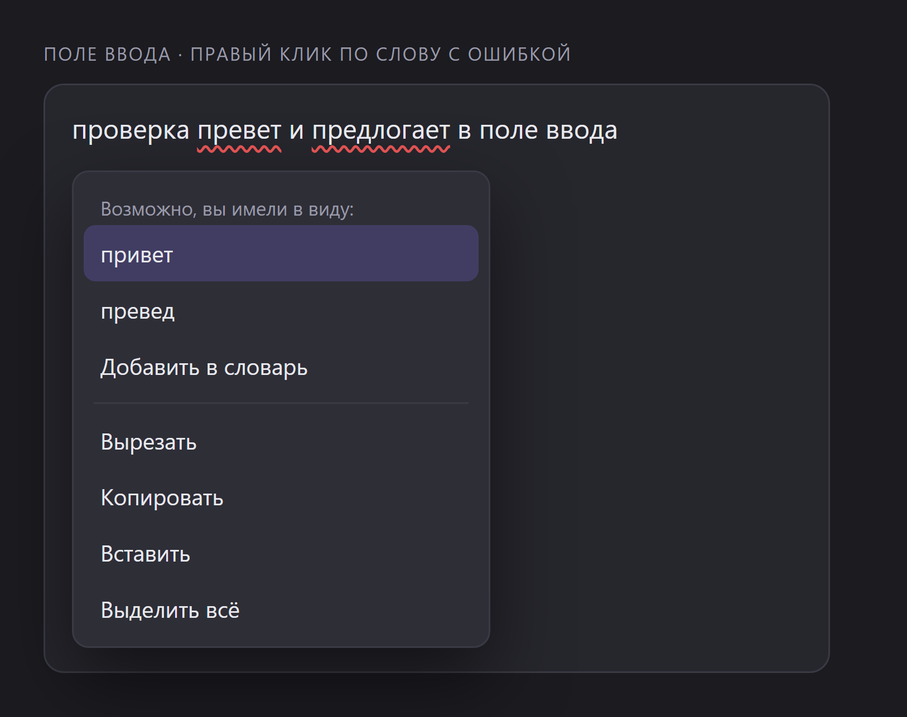
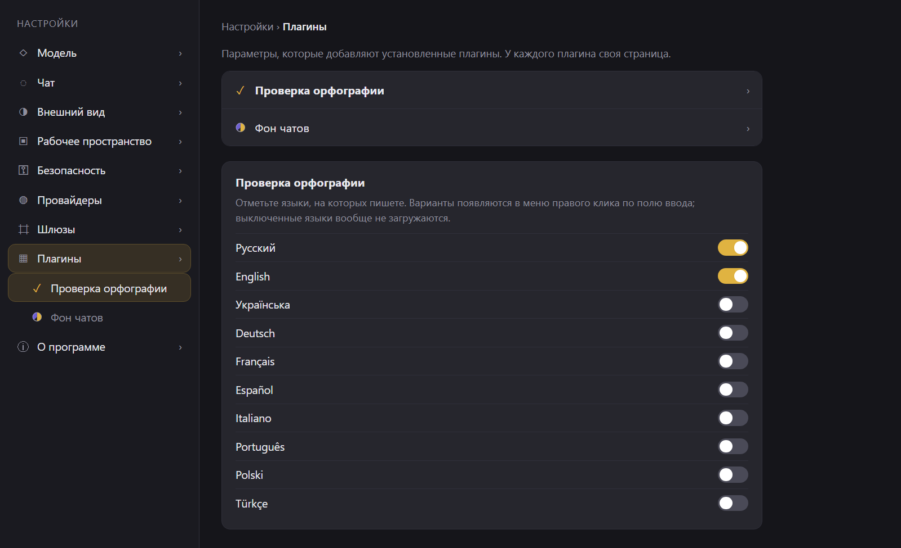

# Spellcheck Plus для Hermes Desktop

Русские, английские (и ещё восемь) варианты замены для слов с опечатками в поле ввода Hermes: **правый клик по слову → «Возможно, вы имели в виду: …» → один клик заменяет слово**. Языки включаются и выключаются в Настройки ▸ Плагины, выключенные даже не распаковываются.

[English version below](#english)



| Английский | Немецкий интерфейс приложения |
|---|---|
|  |  |


## Зачем

Hermes рисует меню правого клика сам (свой React-меню вместо системного). Из-за этого до меню не доезжают данные проверки орфографии, которые Chromium отдаёт в событии `context-menu`: подчёркивание видно, а списка вариантов нет.

Плагин закрывает ровно эту дыру штатным путём — через слот `COMPOSER_AREAS.contextMenu` из plugin SDK. Никакого доступа к DOM приложения, никаких патчей ядра: приложение само говорит плагину «под курсором такое-то слово», а плагин возвращает строки меню.

## Что внутри

- Словари — частотные списки из [FrequencyWords](https://github.com/hermitdave/FrequencyWords) (MIT, 2018): русский 200 000 словоформ, украинский 44 303, английский 46 691, немецкий 49 305, французский 46 687, испанский 49 520, итальянский 45 114, португальский 43 952, польский 49 635, турецкий 48 515.
- Словари упакованы в `plugin.js` через gzip + base64: файл ~3.6 МБ на десять языков, распаковка ~60 мс на язык при старте, индекс ~150 мс — в фоне, меню не ждёт.
- Поиск вариантов: расстояние Дамерау ≤ 1 для всех слов; ≤ 2 — только если первой правки не хватило, с жёстким бюджетом 45 мс / 30 000 кандидатов. Худший замер — 17 мс.
- Защита от ложных срабатываний: вторая правка не применяется, если слово похоже на словоформу известного (`орфографи-я` → есть `орфографии`).
- «Добавить в словарь» кладёт слово в словарь Chromium — подчёркивание снимается сразу.

## Установка

```bash
git clone https://github.com/samieshmil-blip/hermes-spellcheck-plus
mkdir -p ~/.hermes/desktop-plugins/spellcheck-plus   # Windows: %LOCALAPPDATA%\hermes\desktop-plugins\spellcheck-plus
cp -r hermes-spellcheck-plus/desktop/plugin.js ~/.hermes/desktop-plugins/spellcheck-plus/
```

Файл подхватывается за пару секунд, перезапуск приложения не нужен (hot reload). Проверить: правый клик в поле ввода по слову с опечаткой.

Красное подчёркивание — это нативная проверка Chromium; в текущих сборках Hermes поле ввода создаётся с `spellcheck="false"`, поэтому для подчёркивания нужен патч приложения (см. ниже). Подсказки плагина работают и без него.

### Красные подчёркивания (необязательно)

Пока upstream не отдал плагинам опцию включать проверку для composer'а ([PR #143057](https://github.com/NousResearch/hermes-agent/pull/143057)), вкл. двумя правками в уже собранном приложении — `patches/ru-spellcheck` из этого репозитория:

```bash
node patches/apply-fix.cjs      # идемпотентно, кладёт .bak рядом, копирует словари Hunspell
```

Скрипт правит `dist/electron-main.mjs` (языки словаря `ru` + `en-US`) и `dist/assets/main-*.js` (`spellCheck: true` для поля ввода), после чего Chromium подчёркивает опечатки. Обновление приложения перезаписывает файлы — скрипт запускается повторно (или кладётся в автозагрузку).

#### После обновления приложения — автоматически

Каждое обновление Hermes перезаписывает собранный bundle, поэтому патч нужно наложить заново. Это делает сторож `watcher/hermes-spell-watch.exe` (C#, ~8 КБ, собирается `watcher/build.cmd` тем `csc.exe`, что уже есть в Windows): он не опрашивает ничего по таймеру, а спит на `FileSystemWatcher` и просыпается только когда в папке приложения меняются файлы — то есть ровно в момент обновления. Одна дополнительная проверка — при старте (вход в систему).

Проверять «при открытии Hermes» поздно: приложение к этому моменту уже прочитало свои файлы, и свежий патч потребовал бы ещё одного перезапуска. Поэтому сторож срабатывает на перезапись файлов обновлением — тогда следующий запуск уже с подчёркиванием.

Установка один раз:

1. скопировать `patches/` в `%LOCALAPPDATA%\hermes\patches\ru-spellcheck\`;
2. запустить `apply-fix.cmd` (накладывает патч и копирует словари);
3. положить ярлык на `hermes-spell-watch.exe` в автозагрузку (`%APPDATA%\Microsoft\Windows\Start Menu\Programs\Startup\`);
4. запустить этот ярлык сейчас (или войти заново в систему);
5. перезапустить Hermes.

Дальше вмешательство не нужно. Стоимость в простое: один процесс ~35 МБ (private ~33 МБ), 0 % CPU — событий нет, работы нет. Логи: `watch.log` и `apply-fix.log`.

## Языки в настройках

Настройки ▸ Плагины ▸ **Проверка орфографии** (название берётся из языка интерфейса: в английском UI это Spellcheck Plus, в немецком Rechtschreibprüfung и т. д.) — список языков с переключателями: Русский, English, Українська, Deutsch, Français, Español, Italiano, Português, Polski, Türkçe. По умолчанию включены русский и английский; выбор хранится в профиле плагина (`ctx.storage`), применяется сразу, выключенный язык не распаковывается в память.



Добавить новый язык = добавить частотный список в `tools/build-dictionaries.mjs` (одна строка в `LANGS`: подпись, алфавит, набор письма, файл, лимит) и пересобрать `plugin.js`.

Интерфейс переведён на все локали приложения: `en, ru, zh, zh-hant, ja, ar, fr, de, es`.

## Ограничения

- Проверяются только языки из словаря плагина (русский, английский). Добавить язык = добавить частотный список и алфавит в `desktop/plugin.js` (см. `tools/build-dictionaries.mjs`).
- Подсказки эвристические: вариант может быть не первым в списке, а иногда его не будет вовсе — подчёркивание при этом остаётся.
- Плагин не делает морфологический разбор: словоформы, которых нет в частотном списке, могут не найтись.

## Разработка

```bash
node tools/build-dictionaries.mjs   # пересобрать plugin.js из списков в data/
node --check desktop/plugin.js      # синтаксис
hermes plugins validate .           # проверки каталога
hermes plugins doctor .
```

Исходник шаблона — `tools/plugin.template.js`, данные качает `tools/build-dictionaries.mjs` (FrequencyWords, MIT).

## Лицензия

MIT, см. [LICENSE](LICENSE). Словари — FrequencyWords (MIT).

---

## English

Russian and English replacement suggestions for misspelled words in the Hermes Desktop composer: **right-click a word → “Did you mean: …” → one click replaces it**. Languages are toggled in Settings ▸ Plugins.


**Why.** Hermes renders its own context menu and never gives the app Chromium's spell-check payload (`context-menu` params). The red underline shows up, the suggestion list does not. This plugin fills that gap through the supported plugin SDK slot `COMPOSER_AREAS.contextMenu` — no DOM reach-in, no core patches.

**How.** Frequency word lists from [FrequencyWords](https://github.com/hermitdave/FrequencyWords) (MIT): ru 200k forms, plus en, uk, de, fr, es, it, pt, pl, tr (~45–50k each), gzip+base64 inside `plugin.js`. Damerau distance ≤ 1 candidates everywhere, distance ≤ 2 only as a fallback, capped at 45 ms / 30,000 candidates (worst measured: 17 ms). Languages are toggled in Settings ▸ Plugins; a disabled language is never decompressed.

**Install.** Copy `desktop/plugin.js` into `~/.hermes/desktop-plugins/spellcheck-plus/` (`%LOCALAPPDATA%\hermes\desktop-plugins\spellcheck-plus` on Windows). Hot-reloads in seconds.

**Settings.** Settings ▸ Plugins ▸ *Spellcheck Plus* (the entry is named in the UI language: «Проверка орфографии» in Russian, Rechtschreibprüfung in German, …), with one switch per bundled language. See `docs/screenshots/where-to-find.png`.

**Underlines** come from Chromium and need the app-side `spellcheck` flag; `patches/apply-fix.cjs` sets it (idempotent, reverts on app updates — rerun).

MIT licensed.
