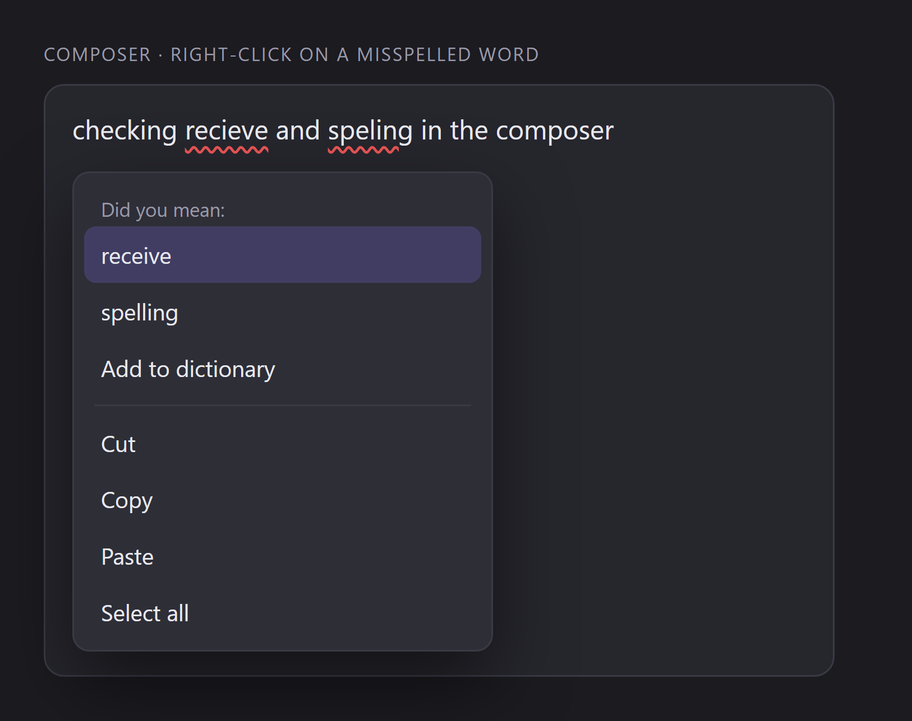
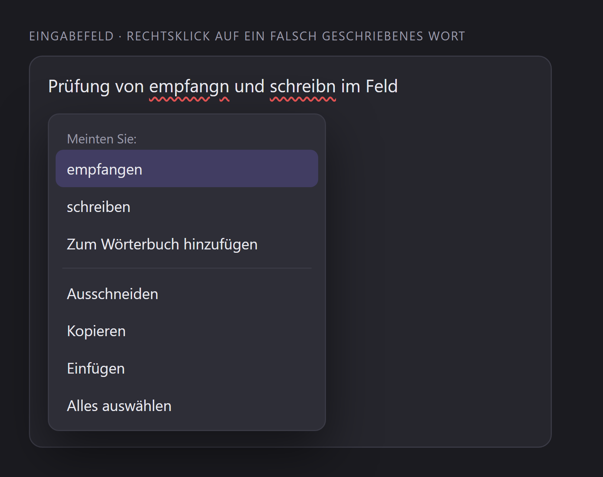
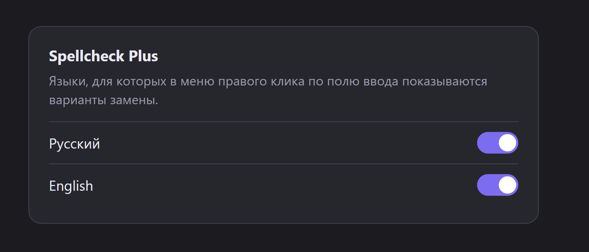

# Spellcheck Plus для Hermes Desktop

Русские и английские варианты замены для слов с опечатками в поле ввода Hermes: **правый клик по слову → «Возможно, вы имели в виду: …» → один клик заменяет слово**. Языки включаются и выключаются в Настройки ▸ Плагины.

[English version below](#english)


| Английский | Немецкий интерфейс приложения |
|---|---|
|  |  |



## Зачем

Hermes рисует меню правого клика сам (свой React-меню вместо системного). Из-за этого до меню не доезжают данные проверки орфографии, которые Chromium отдаёт в событии `context-menu`: подчёркивание видно, а списка вариантов нет.

Плагин закрывает ровно эту дыру штатным путём — через слот `COMPOSER_AREAS.contextMenu` из plugin SDK. Никакого доступа к DOM приложения, никаких патчей ядра: приложение само говорит плагину «под курсором такое-то слово», а плагин возвращает строки меню.

## Что внутри

- Словари — частотные списки русского (200 000 словоформ) и английского (46 691 слово) языков из [FrequencyWords](https://github.com/hermitdave/FrequencyWords) (2018), лицензия MIT.
- Словари упакованы в `plugin.js` через gzip + base64: сам файл ~1.6 МБ, распаковка ~60 мс при старте, индекс ~200 мс — в фоне, меню не ждёт.
- Поиск вариантов: расстояние Дамерау ≤ 1 (перестановки, замены, вставки, удаления) для всех слов, ≤ 2 — только если первой правки не хватило и слово не короче 5 букв, с жёстким бюджетом 40 мс / 20 000 кандидатов. Худший замер — 16 мс.
- Защита от ложных срабатываний: если слово похоже на словоформу известного (`орфографи-я` → есть `орфографии`), подсказки не показываются.
- «Добавить в словарь» кладёт слово в словарь Chromium — подчёркивание снимается сразу.

## Установка

```bash
git clone https://github.com/samieshmil-blip/hermes-spellcheck-plus
mkdir -p ~/.hermes/desktop-plugins/spellcheck-plus   # Windows: %LOCALAPPDATA%\hermes\desktop-plugins\spellcheck-plus
cp -r hermes-spellcheck-plus/desktop/plugin.js ~/.hermes/desktop-plugins/spellcheck-plus/
```

Файл подхватывается за пару секунд, перезапуск приложения не нужен (hot reload). Проверить: правый клик в поле ввода по слову с опечаткой.

Красное подчёркивание — это нативная проверка Chromium; в текущих сборках Hermes поле ввода создаётся с `spellcheck="false"`, поэтому для подчёркивания нужен патч приложения (см. ниже). Подсказки плагина работают и без него.

### Красные подчёркивания (необязательно)

Пока upstream не отдал плагинам опцию включать проверку для composer'а ([PR #143057](https://github.com/NousResearch/hermes-agent/pull/143057)), вкл. двумя правками в уже собранном приложении — `patches/ru-spellcheck` из этого репозитория:

```bash
node patches/apply-fix.cjs      # идемпотентно, кладёт .bak рядом, копирует словари Hunspell
```

Скрипт правит `dist/electron-main.mjs` (языки словаря `ru` + `en-US`) и `dist/assets/main-*.js` (`spellCheck: true` для поля ввода), после чего Chromium подчёркивает опечатки. Обновление приложения перезаписывает файлы — скрипт запускается повторно (или кладётся в автозагрузку).

## Настройки

Настройки ▸ Плагины ▸ **Spellcheck Plus** — два переключателя: Русский, English. Выбор хранится в профиле плагина (`ctx.storage`), применяется сразу.

Интерфейс переведён на все локали приложения: `en, ru, zh, zh-hant, ja, ar, fr, de, es`.

## Ограничения

- Проверяются только языки из словаря плагина (русский, английский). Добавить язык = добавить частотный список и алфавит в `desktop/plugin.js` (см. `tools/build-dictionaries.mjs`).
- Подсказки эвристические: вариант может быть не первым в списке, а иногда его не будет вовсе — подчёркивание при этом остаётся.
- Плагин не делает морфологический разбор: словоформы, которых нет в частотном списке, могут не найтись.

## Разработка

```bash
node tools/build-dictionaries.mjs   # пересобрать plugin.js из списков в data/
node --check desktop/plugin.js      # синтаксис
hermes plugins validate .           # проверки каталога
hermes plugins doctor .
```

Исходник шаблона — `tools/plugin.template.js`, данные качает `tools/build-dictionaries.mjs` (FrequencyWords, MIT).

## Лицензия

MIT, см. [LICENSE](LICENSE). Словари — FrequencyWords (MIT).

---

## English

Russian and English replacement suggestions for misspelled words in the Hermes Desktop composer: **right-click a word → “Did you mean: …” → one click replaces it**. Languages are toggled in Settings ▸ Plugins.


**Why.** Hermes renders its own context menu and never gives the app Chromium's spell-check payload (`context-menu` params). The red underline shows up, the suggestion list does not. This plugin fills that gap through the supported plugin SDK slot `COMPOSER_AREAS.contextMenu` — no DOM reach-in, no core patches.

**How.** Frequency word lists (RU 200k forms, EN 46,691 words) from [FrequencyWords](https://github.com/hermitdave/FrequencyWords) (MIT), gzip+base64 inside `plugin.js`. Damerau distance ≤ 1 candidates everywhere, distance ≤ 2 only as a fallback for words of 5+ letters, capped at 40 ms / 20,000 candidates (worst measured: 16 ms). A morphology guard suppresses suggestions for words that look like a form of a known word.

**Install.** Copy `desktop/plugin.js` into `~/.hermes/desktop-plugins/spellcheck-plus/` (`%LOCALAPPDATA%\hermes\desktop-plugins\spellcheck-plus` on Windows). Hot-reloads in seconds.

**Underlines** come from Chromium and need the app-side `spellcheck` flag; `patches/apply-fix.cjs` sets it (idempotent, reverts on app updates — rerun).

MIT licensed.
